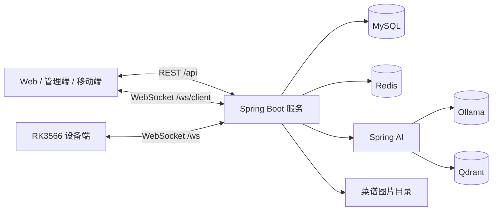
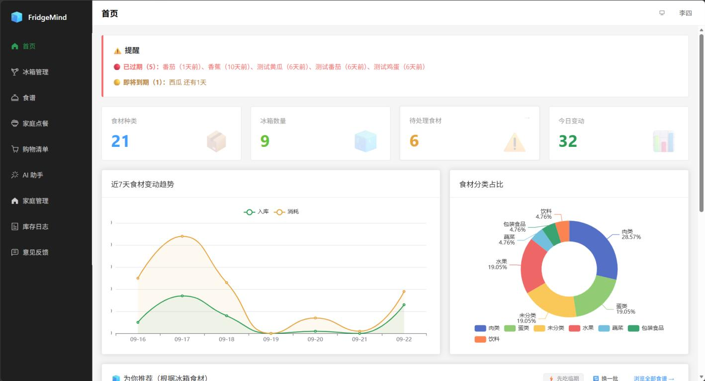
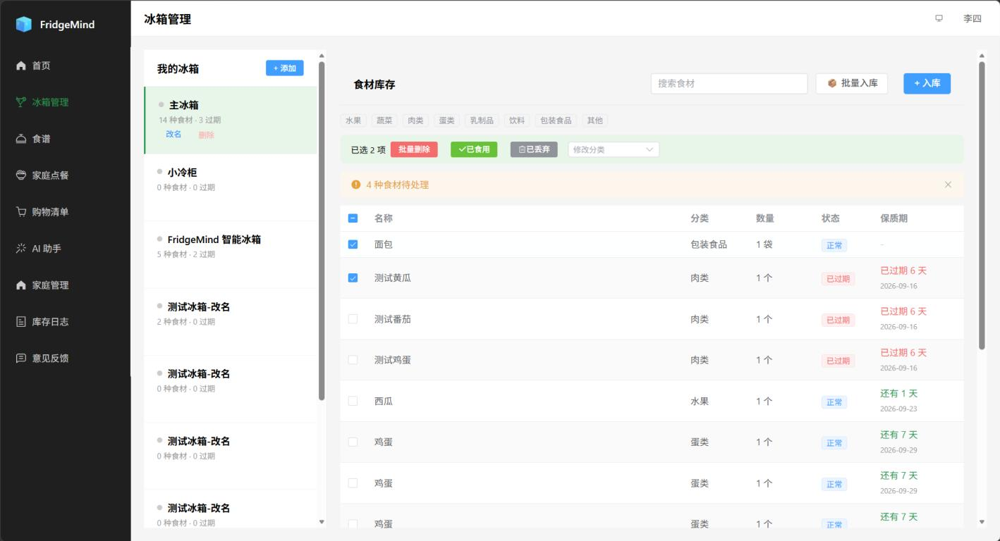
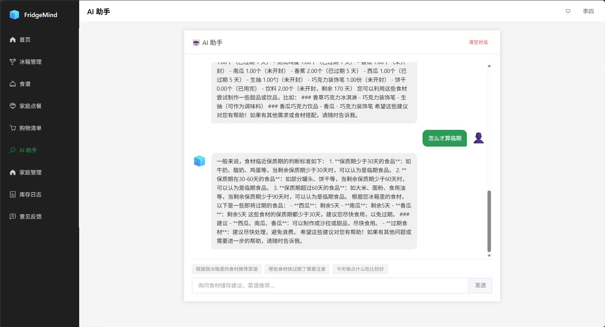
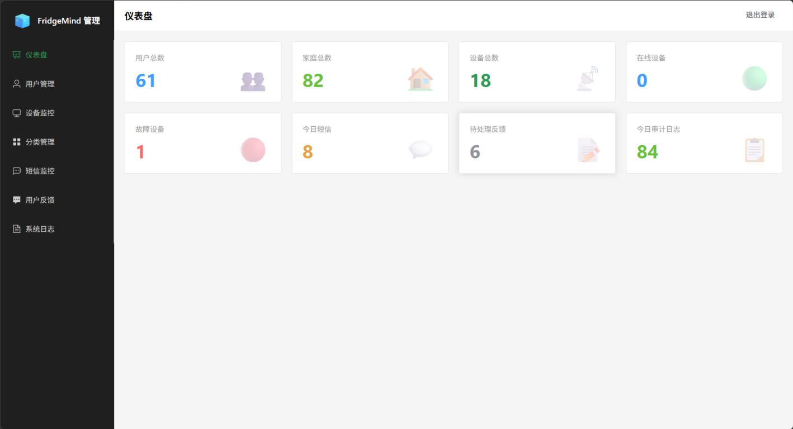
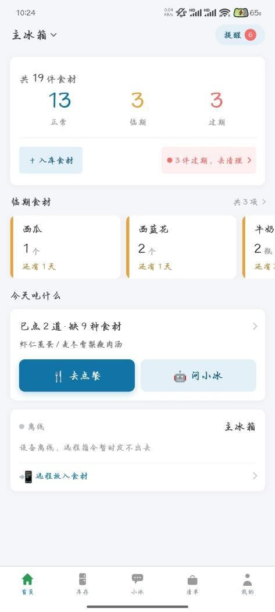
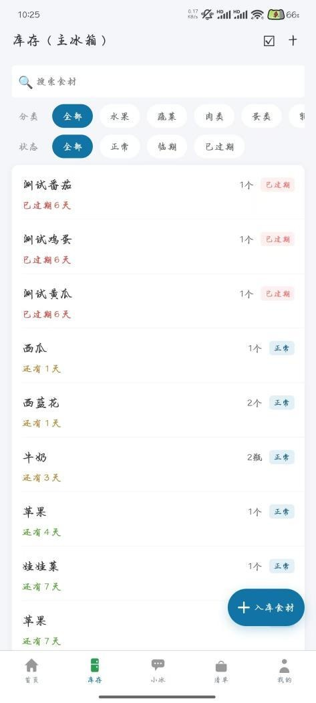
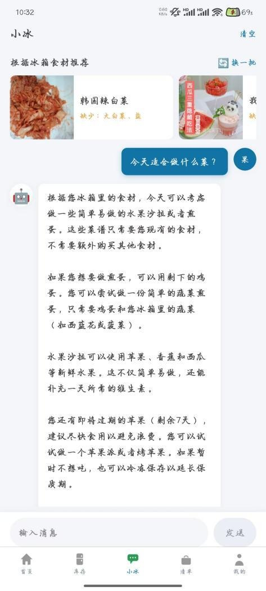

# FridgeMind Backend

**智能冰箱食材管理与家庭协同服务**

## 项目简介

FridgeMind 围绕“冰箱里有什么、今天吃什么、该买什么”，将设备识别、家庭共享、库存管理、临期提醒、食谱检索、家庭点餐和购物清单串成一条完整业务链路。

服务端承担账号与权限、家庭数据隔离、库存状态一致性、设备长连接、实时同步以及 AI 检索编排等职责。系统支持 Web、移动端和管理端共用同一套后端能力。

## 核心能力

- **账号与权限**：手机验证码登录、密码登录、JWT 鉴权、家庭成员校验、管理员独立鉴权与审计日志。
- **家庭与冰箱**：创建/加入家庭、二维码邀请、成员管理、多冰箱管理及设备序列号绑定。
- **食材库存**：单条/批量入库、消耗、丢弃、批量修改、临期提醒、库存变动记录和自动过期巡检。
- **食谱与 AI**：关键词检索、向量语义检索、家庭收藏、库存上下文问答、按现有食材推荐菜谱。
- **点餐与采购**：家庭点餐、缺料汇总、菜单归档、购物清单勾选与清理。
- **实时协同**：`/ws` 面向设备端，`/ws/client` 面向用户端，推送设备状态与库存变化。
- **运营管理**：用户、设备、分类、短信、反馈和审计日志管理。

## 技术栈

| 组件 | 版本 |
| --- | --- |
| Java | 21 |
| Spring Boot | 3.4.3 |
| Spring Framework | 6.2.3 |
| Spring WebSocket | 6.2.3 |
| Spring AI | 1.0.9 |
| MyBatis-Plus | 3.5.5 |
| JJWT | 0.12.3 |
| Lombok | 1.18.36 |
| Hutool | 5.8.24 |
| ZXing | 3.5.3 |
| Maven | 3.9+ |
| MySQL | 8.0+ |
| Redis | 7.4.9 |
| Ollama | 0.32.15 |
| Qdrant | 1.18.2 |

## 系统架构



REST 接口统一使用 `/api` 前缀，由三级拦截器分别处理用户登录态、家庭上下文和管理员权限。设备与用户端通过不同 WebSocket 端点接入，服务端以会话注册表维护在线连接并完成消息分发。

## 代码结构

```text
src/main/java/com/fridgemind/
├── controller      REST 接口
├── service         业务接口与实现
├── mapper          MyBatis-Plus 数据访问
├── entity         数据库实体
├── dto / vo        请求与响应模型
├── security        JWT、身份拦截器与上下文
├── device          WebSocket 网关和会话管理
├── ai              库存上下文、RAG 与 AI 工具
├── task            过期巡检定时任务
├── config          WebMvc、Redis、MyBatis-Plus 配置
└── common          统一响应、异常和校验组件

src/main/resources/
├── application.yml
├── db/schema.sql
└── prompts/ai-chat-system.st
```

## 运行截图

以下截图来自项目实际运行环境。

### Web 端与管理端

<table>
  <tr>
    <td width="50%" align="center"><br /><sub>首页数据看板</sub></td>
    <td width="50%" align="center"><br /><sub>食材库存管理</sub></td>
  </tr>
  <tr>
    <td width="50%" align="center"><br /><sub>AI 食材助手</sub></td>
    <td width="50%" align="center"><br /><sub>管理端仪表盘</sub></td>
  </tr>
</table>

### 安卓端

<table>
  <tr>
    <td width="25%" align="center"><br /><sub>首页</sub></td>
    <td width="25%" align="center"><br /><sub>食材库存</sub></td>
    <td width="25%" align="center"><br /><sub>AI 助手</sub></td>
    <td width="25%" align="center"><br /><sub>家庭点餐</sub></td>
  </tr>
</table>

## 本地运行

### 环境要求

- JDK 21
- Maven 3.9+
- MySQL 8.0+
- Redis
- Ollama 与 Qdrant（使用 AI 问答、语义检索和推荐时需要）

### 1. 获取代码

```powershell
git clone https://github.com/Adabana2007/FridgeMind.git
cd FridgeMind
```

### 2. 初始化数据库

建表脚本会自动创建数据库，在项目根目录执行：

```powershell
cmd /c "mysql -uroot -p < src\main\resources\db\schema.sql"
```

### 3. 配置运行环境

PowerShell 示例：

```powershell
$env:MYSQL_HOST="localhost"
$env:MYSQL_PORT="3306"
$env:MYSQL_DB="fridgemind"
$env:MYSQL_USERNAME="root"
$env:MYSQL_PASSWORD="your-password"

$env:REDIS_HOST="localhost"
$env:REDIS_PORT="6379"

$env:JWT_SECRET="replace-with-a-long-random-secret"
$env:RECIPE_BASE_DIR="data/recipes"
```

AI 相关配置可按本机环境补充：

```powershell
$env:OLLAMA_BASE_URL="http://localhost:11434"
$env:OLLAMA_CHAT_MODEL="Qwen2.5:7B"
$env:OLLAMA_EMBED_MODEL="bge-m3"
$env:QDRANT_HOST="localhost"
$env:QDRANT_PORT="6334"
```

未启动 Ollama 或 Qdrant 时，基础库存管理功能仍可使用，但 AI 问答、向量检索和智能推荐能力会受限。

### 4. 启动服务

```powershell
mvn spring-boot:run
```

服务默认监听 `9090` 端口，健康检查地址：

```text
http://localhost:9090/actuator/health
```

构建可执行包：

```powershell
mvn clean package
```

## 主要配置

| 环境变量 | 默认值 | 说明 |
| --- | --- | --- |
| `MYSQL_HOST` | `localhost` | MySQL 地址 |
| `MYSQL_PORT` | `3306` | MySQL 端口 |
| `MYSQL_DB` | `fridgemind` | 数据库名 |
| `MYSQL_USERNAME` | `root` | 数据库用户名 |
| `MYSQL_PASSWORD` | `1234` | 数据库密码，部署时务必覆盖 |
| `REDIS_HOST` | `localhost` | Redis 地址 |
| `REDIS_PORT` | `16379` | Redis 端口 |
| `JWT_SECRET` | 开发用默认值 | JWT 密钥，部署时务必覆盖 |
| `OLLAMA_CHAT_MODEL` | `Qwen2.5:7B` | 对话模型 |
| `OLLAMA_EMBED_MODEL` | `bge-m3` | 向量模型 |
| `QDRANT_COLLECTION` | `fridgemind_recipes` | 菜谱向量集合 |
| `SMS_MOCK` | `true` | 是否使用模拟短信 |
| `RECIPE_BASE_DIR` | 本机菜谱目录 | 菜谱图片静态目录 |

## 接口概览

| 模块 | 前缀 | 示例 |
| --- | --- | --- |
| 用户与登录 | `/api/user` | `/send-code`、`/login-by-pwd`、`/info` |
| 家庭 | `/api/family` | `/create`、`/join`、`/qr-code` |
| 冰箱 | `/api/fridge` | `/add`、`/list` |
| 食材库存 | `/api/ingredient` | `/list`、`/batch`、`/{id}/consume` |
| 食谱与 AI | `/api/recipes`、`/api/ai` | `/api/recipes/search`、`/api/ai/chat` |
| 点餐与购物 | `/api/meal`、`/api/shopping` | `/api/meal/history`、`/api/shopping/list` |
| 设备 | `/api/device` | `/status`、`/remote-add` |
| 管理端 | `/api/admin` | `/dashboard`、`/users`、`/audit-logs` |
| 实时通道 | `/ws`、`/ws/client` | 设备接入、用户端推送 |

## License

本项目采用 [MIT License](LICENSE)。
